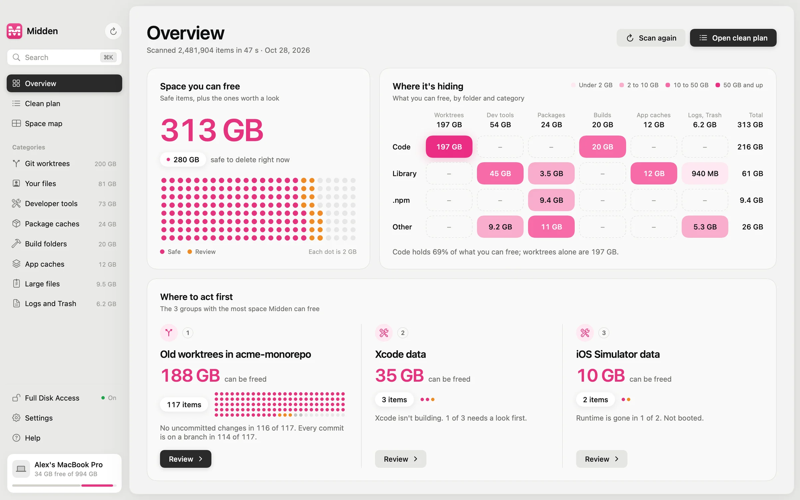

<p align="center">
  
</p>

<p align="center">
  <a href="https://github.com/bazarkua/midden/actions/workflows/tests.yml"></a>
  
  
  <a href="LICENSE"></a>
</p>

# Midden

Midden finds what is safe to delete on your Mac and shows you why. It is built for people who use AI coding agents every day: Claude Code and Codex create git worktrees for parallel tasks and leave them behind, and each one can hold gigabytes of `node_modules`.

This repository is the engine: the scanner, the safety rules, the cleaner and the `midden` command-line tool. It is open source under the MIT license, so anyone can read exactly what Midden checks before it deletes something. The Midden app for Mac is built on this engine.

<p align="center">
  <picture>
    <source media="(prefers-color-scheme: dark)" srcset="docs/assets/overview-dark.webp">
    
  </picture>
</p>

## Why it exists

The disk on my Mac was 97% full. The biggest single cause was 117 old worktrees that Claude Code had created in one repository, 191 GiB in total. None of them had uncommitted changes and every commit was on a branch, so all of them could go. Proving that by hand meant running `git status`, `git branch --contains` and `lsof` across all of them. Midden runs the same checks in one scan and shows you the result for each worktree.

## What it finds

| | Examples | How Midden decides |
|---|---|---|
| Git worktrees | `.claude/worktrees`, `~/.codex/worktrees`, agent worktrees in `/tmp` | Seven checks: uncommitted changes, ignored files, changes hidden from git, commit on a branch, locked, in use by a program, last used |
| Build folders | `node_modules`, `target`, `.next`, `.venv`, `Pods`, SwiftPM's `.build` | Only when the project file sits next to it. Safe once the project has been idle for 14 days. In `.build`, Midden keeps what `swift package clean` keeps. Python environments are found by their `pyvenv.cfg` under any name and are always Review |
| Developer tools | Xcode DerivedData and device support, simulators whose runtime is gone, extension versions VS Code marked for removal | Xcode rebuilds or copies them again. The newest device support version per platform is Review. Android images and Docker data are explained, not deleted |
| Package caches | npm, Gradle, Cargo, uv, pip, CocoaPods, Yarn, Go, and the downloads of Poetry and pnpm | Downloaded again when a project needs them. Gradle's caches only while no Gradle daemon or build runs. Poetry's virtual environments and `pnpm dlx` packages are Review. renv's package library is never deleted |
| App caches | `~/Library/Caches`, web caches of Electron apps, browsers' offline site data | Safe only for owners Midden knows, such as browsers' disk caches and Homebrew's downloads. Any other folder in Caches is Review, because being there doesn't prove it can be rebuilt. Browser profiles and offline site data are Review. Midden asks you to quit the app first |
| Logs and Trash | `~/Library/Logs`, the Trash | Only log files older than 7 days are deleted, and every folder stays. Emptying the Trash is Review |
| AI tool data | `~/.claude`, `~/.codex`, Cursor, Antigravity, Gemini CLI, Ollama and llama.cpp models | Conversation history, settings and models are explained, never deleted |
| Your files | Large files, installers, Downloads, iPhone backups | Explained and never deleted for you. Large files and installers go to the Trash when you choose, so they can be restored |

Every finding gets one of three levels:

- **Safe**: the tool or app that owns it recreates it by itself.
- **Review**: deletable, but it costs something, such as a rebuild, a large download, or a folder you used this week.
- **Info**: explained and left to you. Midden never deletes these on its own; your large files can go to the Trash when you choose.

## Before anything is deleted

A scan can be an hour old when you press Clean. So the cleaner trusts nothing from it and checks every item again from scratch:

1. The path must be inside your home folder, contain no symbolic links, and still match the same rule the scanner used.
2. Worktrees are audited again. A worktree that got new changes in the meantime is refused, with the reason.
3. If the app that owns a cache is running, Midden asks you to quit it first. Some items also need that no program uses them: a download in progress, a browser started on a profile, a command run from a package cache. If one does, or Midden can't read every program, it refuses.
4. A folder that holds something Midden keeps is never deleted as a whole. R's cache folder holds renv's package library, which your R projects link to, so Midden lists the parts of that folder separately and keeps the library.
5. Worktrees are removed with `git worktree remove`, without `--force`, so git itself refuses a worktree with changes.

## Privacy

Midden needs no account and no sign-up. Scanning and cleaning happen on your Mac, and the report stays there. The engine has no networking code at all: no analytics, no telemetry, nothing uploaded. It imports only Foundation, AppKit and Synchronization, so you can check this yourself with one search:

```sh
git grep -n -E "URLSession|NWConnection|import Network" -- Sources   # no results
```

## Install

**The app.** Midden for Mac is coming to the Mac App Store. A direct download with every feature will be on the [Releases](https://github.com/bazarkua/midden/releases) page.

**The command-line tool.** It needs macOS 15 or later and a Swift 6 toolchain. It is tested with Swift 6.3 and 6.4.

```sh
git clone https://github.com/bazarkua/midden.git
cd midden
swift build -c release
.build/release/midden scan
```

Without Full Disk Access the scan leaves out the folders macOS guards with a permission prompt (Desktop, Documents, Downloads, iCloud Drive, other apps' data) instead of triggering a dialog for each one, and the report lists what it skipped. Give your terminal Full Disk Access (System Settings, Privacy & Security) to include them.

## Usage

```text
$ midden scan
Scanned ~ in 0.1 s: 96 items, 403.2 MB on disk.

Git worktrees  64.0 MB in 1 item
  SAFE    64.0 MB   Claude Code worktree agent-7f3c2a (fix-login-redirect)
                  ~/Code/acme-app/.claude/worktrees/agent-7f3c2a
                  A second checkout of the “acme-app” repository that Claude Code made for a
                  parallel task: it's in a .claude/worktrees folder, where Claude Code puts the
                  worktrees it creates. Removing it deletes this folder only; the branch
                  “fix-login-redirect” and its commits stay in the repository.

Build folders  84.0 MB in 1 item
  SAFE    84.0 MB   node_modules in acme-app
                  ~/Code/acme-app/node_modules
                  Packages installed for the project “acme-app”. `npm install` puts them back.

Developer tools  125.0 MB in 1 item
  SAFE    125.0 MB  Xcode DerivedData
                  ~/Library/Developer/Xcode/DerivedData
                  Build products, intermediate files and indexes Xcode keeps for each project it
                  builds. Xcode recreates them as needed; the next build of each project starts from
                  scratch and takes longer, and Xcode indexes the project again.

Safe to clean: 403.0 MB in 5 items.
Clean an item with `midden clean <path>`; Midden checks it again before deleting.
```

The example above is shortened. It comes from a small demo folder.

```sh
midden clean ~/Code/acme-app/.claude/worktrees/agent-7f3c2a   # asks before deleting
midden scan --json > report.json                              # the full report, for scripts
midden scan --min-size 1GB                                    # only the big items
```

## Performance

On a MacBook Pro with an M4 Pro, a full scan of a 434 GB home folder with 5.3 million items takes 28 seconds. That includes auditing 70 git worktrees and building the space map. `du -skx` took between 100 and 155 seconds on the same folder in my runs.

The sizes are the bytes actually allocated on disk, with hard links counted once, so they match `du`. On folders that didn't change between runs, the totals are equal to the kilobyte.

## How it works

- One parallel pass over the disk. Directories are read with `getattrlistbulk`, which returns a whole batch of entries with their sizes in one system call, on a fixed pool of threads.
- Folder sizes add up after the walk without a second pass: each folder counts its unfinished subfolders and reports to its parent when it reaches zero.
- Rules are plain data in [`Rules.swift`](Sources/MiddenCore/Rules.swift). Each one carries the explanation users see.
- A check that can't run never counts as passed. A watchdog keeps a stuck folder, such as one waiting on a privacy prompt, from stopping the scan.

[docs/ARCHITECTURE.md](docs/ARCHITECTURE.md) explains every design decision and the measurements behind it.

## Use the engine in your own app

```swift
// Package.swift
.package(url: "https://github.com/bazarkua/midden.git", branch: "main")
```

```swift
import MiddenCore

let report = try await Scanner().scan { progress in
    print(progress.phase, progress.fraction ?? 0)
}
for finding in report.findings where finding.safety == .safe {
    print(finding.title, finding.bytes, finding.explanation)
}
```

## Contributing

Midden knows only the leftovers it has rules for. If a tool on your Mac leaves data behind that Midden doesn't explain yet, a new rule is the most useful contribution:

1. Add a rule to [`Sources/MiddenCore/Rules.swift`](Sources/MiddenCore/Rules.swift). The explanation must say what the folder is and what deleting it costs. A Safe rule needs a source for why the owner rebuilds the folder. If the owner keeps something there that must stay, add a rule for that part too: the folder then becomes a container, which Midden never deletes as a whole.
2. Add a row for it to the rule table in [`Tests/MiddenCoreTests/RuleTests.swift`](Tests/MiddenCoreTests/RuleTests.swift).
3. Run `swift test`. It never asks for a permission. Three tests that attach real disk images run only with `MIDDEN_MOUNT_TESTS=1`, and need your terminal to have access to removable volumes (System Settings, Privacy & Security, Files and Folders).

Bug reports and questions go to [Issues](https://github.com/bazarkua/midden/issues).

## License

The engine and the command-line tool are released under the [MIT license](LICENSE). The Midden app's interface is not part of this repository.
